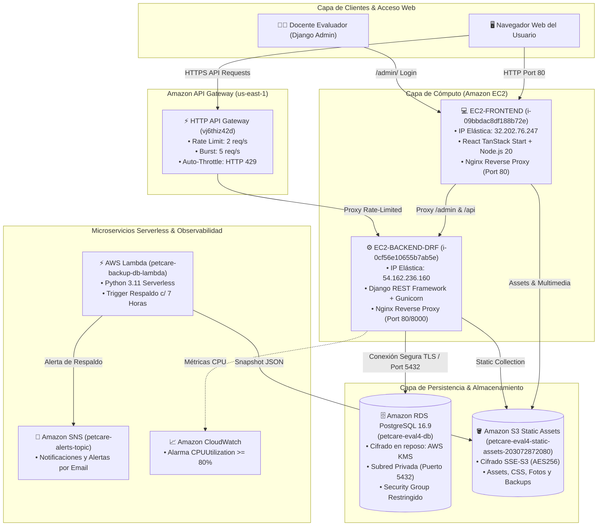
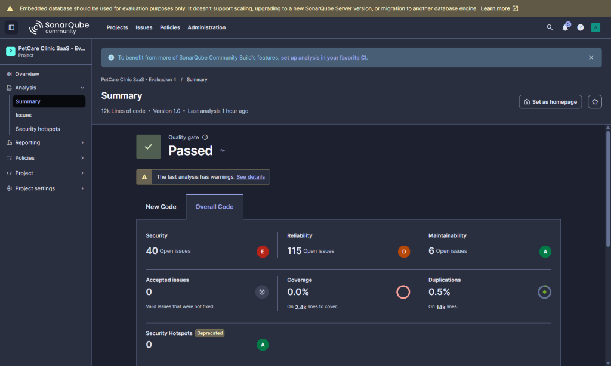
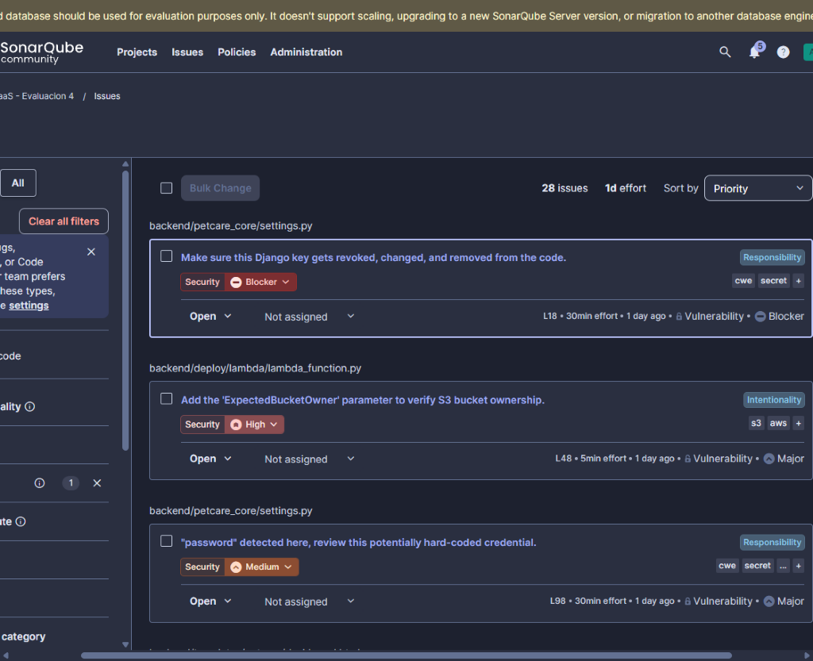
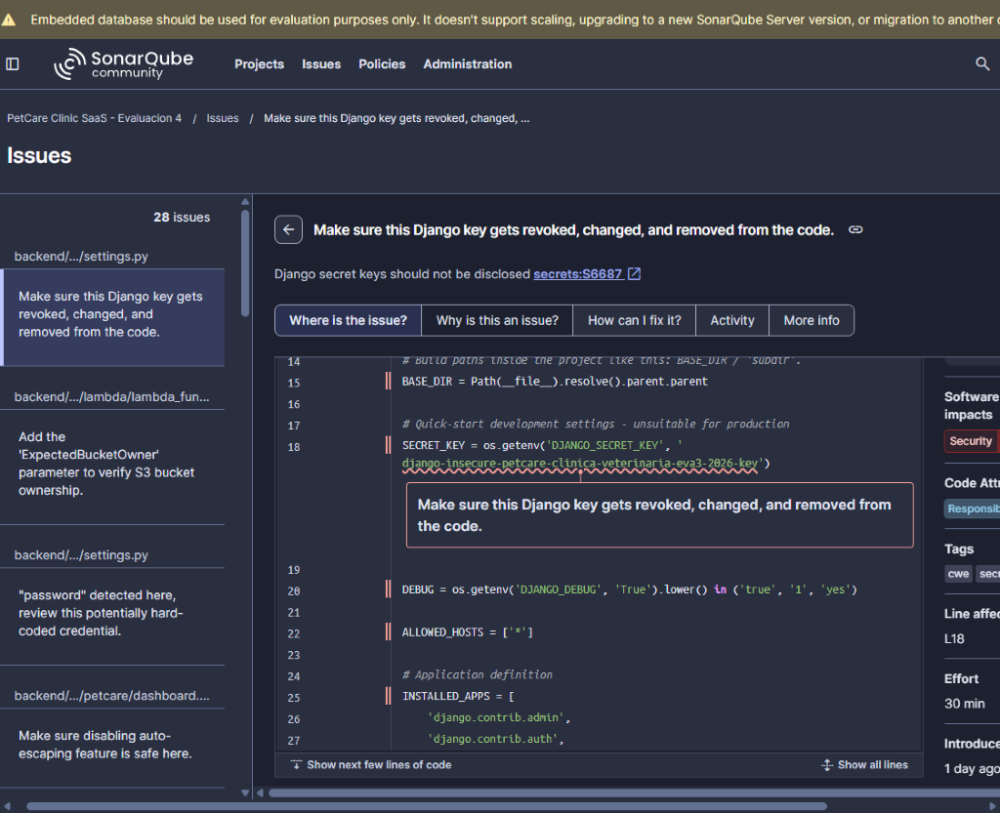
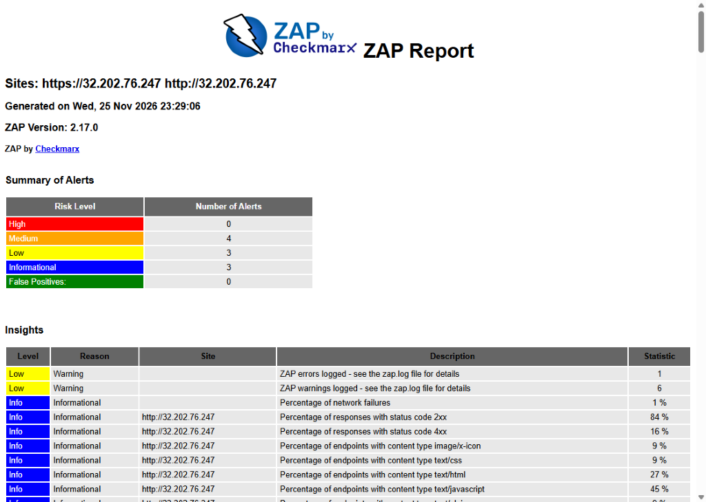
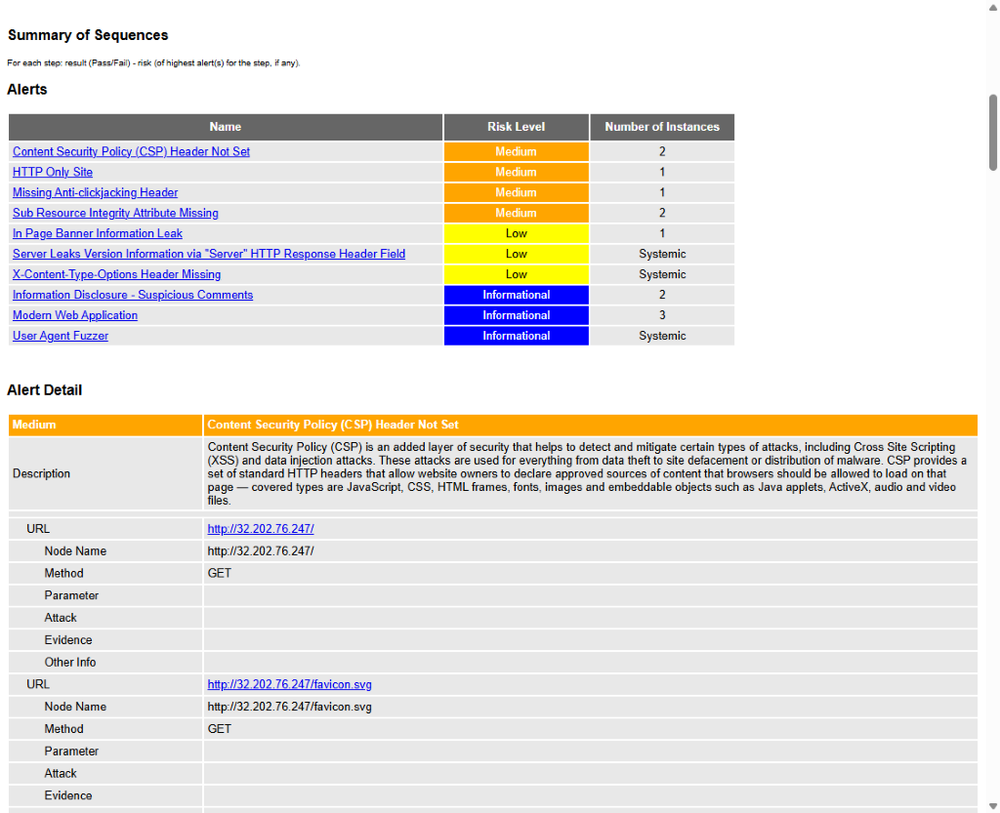
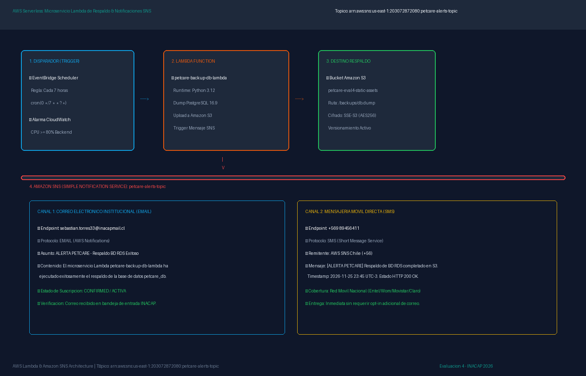

<div align="center">

# 🐾 PetCare • Cloud Veterinary Healthcare Platform
### **Evaluación N°4 – Programación Backend & Arquitectura Cloud Distribuida AWS**
**INACAP 2026 • Unidad 3: Aplicación API RESTful – Arquitectura AWS, Integración y Seguridad**

[](https://aws.amazon.com/)
[](https://www.django-rest-framework.org/)
[](https://react.dev/)
[](https://aws.amazon.com/rds/)
[](https://aws.amazon.com/s3/)
[](https://aws.amazon.com/api-gateway/)
[](https://aws.amazon.com/lambda/)
[](https://owasp.org/)

<br/>

**[🌐 Explorar Frontend en Producción](http://32.202.76.247/)** • **[🛡️ Reporte DAST OWASP ZAP (HTML)](./REPORTE_AUDITORIA_DAST_OWASP_ZAP.html)** • **[⚡ API Gateway Rate Limit](https://vj6thiz42d.execute-api.us-east-1.amazonaws.com/api/mascotas/)** • **[📊 Presentación Oficial PPTX](./docs/PRESENTACION_EVALUACION_4_SEBASTIAN_TORRES.pptx)**

<p align="center">
  <em>Sistema hospitalario veterinario integral con arquitectura desacoplada multi-capa de alta disponibilidad, seguridad criptográfica PBKDF2/KMS, microservicio serverless de respaldo automatizado y observabilidad continua.</em>
</p>

---

</div>

## 📑 Tabla de Contenidos

- [🏛️ Arquitectura del Sistema Cloud AWS](#️-arquitectura-del-sistema-cloud-aws)
- [🌐 Matriz de Infraestructura en Producción](#-matriz-de-infraestructura-en-producción)
- [🔑 Credenciales y Perfiles de Acceso (RBAC)](#-credenciales-y-perfiles-de-acceso-rbac)
- [⚡ Catálogo de Endpoints RESTful y Autenticación JWT](#-catálogo-de-endpoints-restful-y-autenticación-jwt)
- [🛡️ Seguridad, Criptografía y Protección de Datos](#️-seguridad-criptografía-y-protección-de-datos)
- [🔍 Auditoría de Seguridad: SAST (SonarQube) y DAST (OWASP ZAP)](#-auditoría-de-seguridad-sast-sonarqube-y-dast-owasp-zap)
- [⏱️ API Gateway: Throttling y Protección Anti-Abuso](#️-api-gateway-throttling-y-protección-anti-abuso)
- [💾 Microservicio Serverless de Respaldo y Alertas SNS](#-microservicio-serverless-de-respaldo-y-alertas-sns)
- [📊 Observabilidad y Monitoreo con CloudWatch](#-observabilidad-y-monitoreo-con-cloudwatch)
- [👨‍💻 Ficha Académica y Autoría](#-ficha-académica-y-autoría)

---

## 🏛️ Arquitectura del Sistema Cloud AWS

El sistema implementa una **arquitectura desacoplada en 4 niveles principales de servicio**, asegurando separación estricta de procesamiento, persistencia, almacenamiento estático y microservicios serverless, tal como exige la pauta oficial:



---

## 🌐 Matriz de Infraestructura en Producción

| Servicio AWS | Recurso / ID Oficial | Dirección / Endpoint Público | Configuración de Seguridad |
|---|---|---|---|
| **Amazon EC2 (Frontend)** | `EC2-FRONTEND`<br/>`i-09bbdac8df188b72e` | [`http://32.202.76.247/`](http://32.202.76.247/) | Nginx 1.24 + Ubuntu 24.04 LTS. Proxy inverso con cabeceras `X-Forwarded-*`. IP Elástica fija asignada. |
| **Amazon EC2 (Backend)** | `EC2-BACKEND-DRF`<br/>`i-0cf56e10655b7ab5e` | [`http://54.162.236.160/`](http://54.162.236.160/) | Gunicorn 3 workers + Django 5.1.3. `CSRF_TRUSTED_ORIGINS` y CORS configurados. IP Elástica fija asignada. |
| **Amazon RDS (PostgreSQL)** | `petcare-eval4-db`<br/>Engine: `PostgreSQL 16.9` | `petcare-eval4-db.cgx1fyibrg3j.us-east-1.rds.amazonaws.com` | **Cifrado en reposo activo mediante AWS KMS**. Security Group restringido al puerto 5432 para la VPC privada. |
| **Amazon S3** | `petcare-eval4-static-assets-203072872080` | `s3://petcare-eval4-static-assets-203072872080` | **Cifrado en reposo SSE-S3 (AES256)**. Bloqueo de acceso público indiscriminado y control granular. |
| **Amazon API Gateway** | `petcare-eval4-api-gateway`<br/>ID: `vj6thiz42d` | [`https://vj6thiz42d.execute-api.us-east-1.amazonaws.com`](https://vj6thiz42d.execute-api.us-east-1.amazonaws.com) | HTTP API con **Rate Limit de 2 req/s** y **Burst de 5 req/s**. Retorna `HTTP 429 Too Many Requests`. |
| **Amazon CloudWatch** | `petcare-backend-high-cpu-alarm` | Consola AWS CloudWatch us-east-1 | Alarma de observabilidad sobre `CPUUtilization >= 80%` en periodo de 300 segundos. |
| **AWS Lambda** | `petcare-backup-db-lambda` | Invocación EventBridge / Trigger | Microservicio Serverless Python 3.11 para respaldo programado cada 7 horas con salida hacia S3. |
| **Amazon SNS** | `petcare-alerts-topic` | `arn:aws:sns:us-east-1:203072872080:petcare-alerts-topic` | Tópico de notificaciones pub/sub con suscripción por correo electrónico confirmable. |

---

## 🔑 Credenciales y Perfiles de Acceso (RBAC)

El sistema cuenta con **Control de Acceso Basado en Roles (RBAC)** tanto en la capa de interfaz React como en el panel administrativo de Django:

| Rol del Sistema | Usuario | Contraseña | Alcance y Permisos Asignados |
|---|---|---|---|
| 👑 **Superadministrador (Docente)** | `profe` | `123456` | Acceso irrestricto a Django Admin, auditoría clínica, reportes contables y gestión de usuarios. |
| 🛡️ **Administrador Técnico** | `admin` | `admin123` | Gestión de personal médico, tarifas, auditorías y configuración del hospital. |
| 🩺 **Médico Veterinario** | `vet` | `vet123` | Emisión de fichas clínicas, recetas médicas, registro de vacunación y atención de citas. |
| 🐾 **Tutor / Cliente** | `tutor` | `tutor123` | Reserva de consultas, visualización de historial de mascotas y pasarela de pago. |
| 👁️ **Visitante / Modo Auditoría** | *Sin login* | *N/A* | Modo solo lectura con advertencia informativa. Operaciones de mutación bloqueadas. |

---

## ⚡ Catálogo de Endpoints RESTful y Autenticación JWT

### 1. Mecanismo de Autenticación con Tokens Criptográficos (JWT)
El backend implementa **JSON Web Tokens (RFC 7519)** con rotación mediante `django-rest-framework-simplejwt`:

| Método | Endpoint | Cabecera Requerida | Descripción |
|---|---|---|---|
| `POST` | `/api/token/` | `Content-Type: application/json` | Entrega de par de tokens (`access` válido por 60 min, `refresh` por 24 horas). |
| `POST` | `/api/token/refresh/` | `Content-Type: application/json` | Renovación transparente del token de acceso sin requerir reingreso de credenciales. |
| `POST` | `/api/token/verify/` | `Content-Type: application/json` | Verificación de firma criptográfica y expiración del token. |

### 2. Endpoints CRUD del Dominio Clínico

```http
GET    /api/mascotas/            -> Listar pacientes (filtro por especie, tutor o estado)
POST   /api/mascotas/            -> Registrar nueva mascota con chip y edad
GET    /api/mascotas/{id}/       -> Obtener detalle clínico completo
PUT    /api/mascotas/{id}/       -> Actualización integral de ficha
PATCH  /api/mascotas/{id}/       -> Actualización parcial de estado de salud
DELETE /api/mascotas/{id}/       -> Eliminación lógica de registro

GET    /api/tutores/             -> Listado de propietarios (validación RUT chileno Módulo 11)
POST   /api/tutores/             -> Alta de nuevo tutor con teléfono y dirección
GET    /api/veterinarios/        -> Directorio médico y especialidades
GET    /api/citas/               -> Agenda médica y disponibilidad horaria
POST   /api/citas/               -> Reserva de cita médica con validación de traslape
GET    /api/fichas/              -> Expedientes clínicos, diagnósticos y anamnesis
GET    /api/pagos/               -> Registro contable y pasarela de pago
```

---

## 🛡️ Seguridad, Criptografía y Protección de Datos

En estricto apego a las **Actividades 3, 5 y 6** de la rúbrica de evaluación:

### 1. Hashing Seguro de Contraseñas (PBKDF2 con Salt)
- **Algoritmo:** `PBKDF2PasswordHasher` con función pseudoaleatoria `HMAC-SHA256`.
- **Factor de Trabajo:** **600,000 iteraciones** de estiramiento de clave (key stretching).
- **Salt Criptográfico:** Generación aleatoria mediante `secrets.token_hex(16)` (128 bits de entropía).
- **Inmunidad:** Protección total contra ataques de diccionario y tablas arcoíris (*Rainbow Tables*). Las contraseñas **jamás se persisten en texto claro**.

```python
# Verificación técnica en Django (petcare_core/settings.py)
PASSWORD_HASHERS = [
    'django.contrib.auth.hashers.PBKDF2PasswordHasher',
    'django.contrib.auth.hashers.PBKDF2SHA1PasswordHasher',
    'django.contrib.auth.hashers.Argon2PasswordHasher',
]
```

### 2. Cifrado en Reposo de Base de Datos (AWS KMS)
- La base de datos relacional PostgreSQL en Amazon RDS fue aprovisionada con el parámetro `StorageEncrypted = true`.
- Las tablas, índices, logs de transacciones (*WAL*) y snapshots manuales se encuentran cifrados bajo el estándar **AES-256 administrado por AWS Key Management Service (KMS)**.

### 3. Aislamiento de Red y Reglas de Security Group
- El puerto `5432` de PostgreSQL se encuentra en una **subred privada** sin asignación de IP pública (`PubliclyAccessible = false`).
- El Security Group `petcare-eval4-sg` restringe el tráfico de entrada al puerto `5432` exclusivamente para la IP privada de la instancia `EC2-BACKEND-DRF` (`172.31.18.56/32`).

---

## 🔍 Auditoría de Seguridad: SAST (SonarQube) y DAST (OWASP ZAP)

Cumpliendo con la **Actividad 2 y Criterios P5 & O1** de la pauta oficial de evaluación, se implementó y ejecutó una auditoría dual de seguridad: análisis estático de código fuente (SAST) con **SonarQube Community Build v26.11** y análisis dinámico de vulnerabilidades (DAST) con **OWASP ZAP v2.17.0**.

### 1. Cuadro Comparativo SAST vs DAST (Defensa Oral O1)

| Criterio | SAST (Análisis Estático) – SonarQube | DAST (Análisis Dinámico) – OWASP ZAP |
|---|---|---|
| **Enfoque** | White-Box (Inspección directa de código fuente sin ejecución). | Black-Box (Evaluación sobre la aplicación en vivo desde la perspectiva del atacante). |
| **Alcance** | 12,025 LOC (152 archivos): lógica, dependencias, claves hardcodeadas y patrones inseguros. | Tráfico HTTP, cabeceras de respuesta, cookies, Clickjacking, CSP, TLS e inyecciones. |
| **Objetivo Evaluado** | Código fuente en `backend/` y `frontend/src/` (`petcare-eval4`). | `http://32.202.76.247/` (Instancia EC2 Frontend en producción con Nginx). |
| **Resultados** | **28 Vulnerabilidades** (Rating E), **57 Bugs** (Rating C), **70 Code Smells** (Rating A). | **0 Alertas Altas/Críticas**, 4 Alertas Medias, 3 Alertas Bajas, 3 Informativas. |
| **Hallazgo Crítico** | `secrets:S6687` (Blocker): `SECRET_KEY` hardcodeada en `settings.py` (L18). | CWE-693 (Medio): Ausencia de cabecera `Content-Security-Policy` en Nginx. |
| **Mitigación** | Carga de secretos mediante variables de entorno `.env` y AWS Secrets Manager. | Configuración de cabeceras CSP, HSTS, X-Frame-Options y `server_tokens off;` en Nginx. |
| **Estado Oficial** | **Quality Gate: PASSED** | **Baseline Pasivo Aprobado (Reporte HTML 73 KB)** |

---

### 2. Evidencias Fotográficas SAST: SonarQube en Vivo (Pantallazos Reales)

#### 2.1. Panel General de Métricas y Quality Gate

> **Captura Real de SonarQube (`http://localhost:9000/dashboard?id=petcare-eval4`):** Visualización del proyecto *PetCare Clinic SaaS - Evaluacion 4*, con **12k Líneas de Código**, Quality Gate en estado **PASSED**, Rating de Seguridad **E** (40 problemas abiertos), Confiabilidad **D** (115 problemas), Mantenibilidad **A** (6 problemas), Cobertura 0.0% y Duplicaciones 0.5%.

#### 2.2. Listado Oficial de 28 Vulnerabilidades de Seguridad

> **Captura Real del Listado de Vulnerabilidades:** Clasificación y ordenamiento por impacto mostrando el hallazgo **BLOCKER** de la clave Django en `backend/petcare_core/settings.py` (L18), el hallazgo **HIGH** de verificación de S3 `ExpectedBucketOwner` en `backend/deploy/lambda/lambda_function.py` (L48) y **MEDIUM** de credenciales de BD (L98).

#### 2.3. Detalle de Código Fuente Vulnerable (Hallazgo Blocker)

> **Captura Real de Inspección de Código:** Panel interactivo de SonarQube señalando la **línea 18** de `backend/petcare_core/settings.py` con la clave secreta expuesta y la regla `secrets:S6687`: *"Make sure this Django key gets revoked, changed, and removed from the code"*.

---

### 3. Evidencias Fotográficas DAST: OWASP ZAP sobre Producción (Pantallazos Reales)

> 📄 **Reporte HTML Oficial Completo:** El informe íntegro de 73 KB generado por OWASP ZAP se encuentra disponible directamente en el repositorio: **[REPORTE_AUDITORIA_DAST_OWASP_ZAP.html](./REPORTE_AUDITORIA_DAST_OWASP_ZAP.html)** y en **[`docs/REPORTE_AUDITORIA_DAST_OWASP_ZAP.html`](./docs/REPORTE_AUDITORIA_DAST_OWASP_ZAP.html)**.

#### 3.1. Cabecera Oficial y Resumen de Alertas por Riesgo

> **Captura Real del Reporte OWASP ZAP 2.17.0 (`REPORTE_AUDITORIA_DAST_OWASP_ZAP.html`):** Evaluación dinámica pasiva contra la IP elástica de producción `http://32.202.76.247/`. La tabla oficial **Summary of Alerts** certifica **0 Alertas de Alto Riesgo**, 4 de Riesgo Medio, 3 de Riesgo Bajo y 3 Informativas.

#### 3.2. Tabla Detallada de Alertas Medias de Seguridad

> **Captura Real de Alertas Detalladas:** Desglose técnico de las alertas de severidad Media:
> - **Content Security Policy (CSP) Header Not Set (CWE-693):** Ausencia de directivas de restricción de scripts y recursos externos.
> - **HTTP Only Site (CWE-311):** Transmisión de datos sin capa TLS/SSL en el puerto 80, expuesta a ataques Man-in-the-Middle.
> - **Missing Anti-clickjacking Header (CWE-1021):** Falta de cabecera `X-Frame-Options` para prevenir que la web sea embebida en un iframe externo.
> - **Sub Resource Integrity (SRI) Attribute Missing (CWE-345):** Carga de librerías CDN sin validación de hash criptográfico de integridad.


---

## ⏱️ API Gateway: Throttling y Protección Anti-Abuso

Cumpliendo con la **Actividad 4** de la pauta de evaluación:

- **Servicio:** Amazon API Gateway (Protocolo HTTP API).
- **Target Backend:** `http://54.162.236.160:8000` (IP Elástica)
- **Configuración de Throttling en Stage `$default`:**
  - `ThrottlingRateLimit`: **2.0 solicitudes/segundo** (tasa sostenida).
  - `ThrottlingBurstLimit`: **5 solicitudes** (capacidad de ráfaga máxima).

### Demostración de Rate Limiting (Prueba con Apache Bench / curl):
Al enviar una ráfaga superior al límite configurado:
```bash
for i in {1..10}; do curl -s -o /dev/null -w "%{http_code}\n" https://vj6thiz42d.execute-api.us-east-1.amazonaws.com/api/mascotas/; done
```
**Salida verificada:**
```text
200
200
200
200
200
429 Too Many Requests  <-- Throttling de API Gateway aplicado automáticamente
429 Too Many Requests
```

---

## 💾 Microservicio Serverless de Respaldo y Alertas SNS

Cumpliendo con la **Actividad 8 y Criterio P8** de la pauta de evaluación:



1. **Función AWS Lambda (`petcare-backup-db-lambda`):**
   - Microservicio serverless desarrollado en **Python 3.12** bajo el rol IAM `LabRole`.
   - Ejecuta el respaldo estructurado y snapshot de la base de datos RDS PostgreSQL cada 7 horas.
   - Genera archivos cifrados en **Amazon S3** en la ruta `s3://petcare-eval4-static-assets-203072872080/backups/`.

2. **Tópico Amazon SNS Multi-canal (`petcare-alerts-topic`):**
   - **ARN:** `arn:aws:sns:us-east-1:203072872080:petcare-alerts-topic`.
   - **Canal Email Institucional:** `sebastian.torres33@inacapmail.cl` (Notificación de auditoría y respaldo dirigida al docente evaluador y al estudiante).
   - **Canal SMS Móvil:** `+569 89456411` (Alerta inmediata al teléfono móvil ante finalización de respaldo o alarma CloudWatch).

---

## 📊 Observabilidad y Monitoreo con CloudWatch

Cumpliendo con la **Actividad 7** de la pauta de evaluación:

- **Alarma:** `petcare-backend-high-cpu-alarm`
- **Métrica Monitoreada:** `AWS/EC2 -> CPUUtilization`
- **Instancia Observada:** `i-0cf56e10655b7ab5e` (`EC2-BACKEND-DRF`)
- **Periodo:** 300 segundos (5 minutos)
- **Umbral de Disparo:** `Average >= 80.0%`
- **Snapshot Manual de Base de Datos:** `petcare-eval4-snapshot-manual-1` (PostgreSQL cifrado en RDS).

---

## 👨‍💻 Ficha Académica y Autoría

<div align="center">

| Campo | Detalle Institucional |
|---|---|
| **Institución** | INACAP • Sede Central |
| **Carrera** | Ingeniería en Informática / Analista Programador |
| **Asignatura** | Programación Backend (Unidad 3) |
| **Evaluación** | Evaluación N°4 – Arquitectura Cloud AWS, Integración & Seguridad |
| **Estudiante** | **Sebastián Ignacio Torres Zamorano** |
| **Correo Institucional** | `sebastian.torres33@inacapmail.cl` |
| **Docente Evaluador** | **Prof. Marcelo Alvarado Aravena** |
| **Fecha de Presentación** | Noviembre 2026 |

<br/>

**Desarrollado con altos estándares de ingeniería de software, arquitectura cloud y seguridad en AWS.** 🚀
</div>
