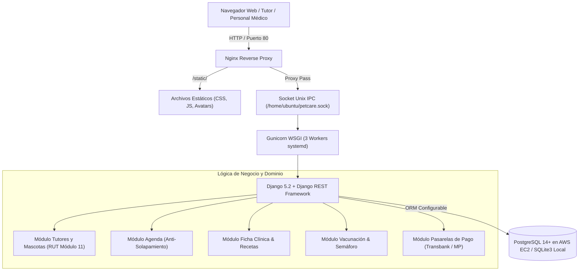

<div align="center">

# 🐾 PetCare • Sistema Integral de Gestión de Citas y Fichas Médicas
### Plataforma Fullstack con Django REST Framework, PostgreSQL y Despliegue en AWS EC2

[](https://www.djangoproject.com/)
[](https://www.django-rest-framework.org/)
[](https://www.postgresql.org/)
[-FF9900?style=for-the-badge&logo=amazonec2&logoColor=white)](https://aws.amazon.com/)
[](https://nginx.org/)
[](https://gunicorn.org/)
[](https://transbankdevelopers.cl/)
[](tests.py)

<p align="center">
  <b>Instituto Profesional INACAP — Área Informática y Ciberseguridad</b><br>
  <b>Asignatura:</b> Desarrollo Backend & Bases de Datos | <b>Evaluación Parcial N°3</b><br>
  <b>Profesor Evaluador:</b> Marcelo Alvarado Aravena<br>
  <b>Estudiante:</b> Sebastián Ignacio Torres Zamorano
</p>

</div>

---

## 📌 Tabla de Contenidos

1. [🏥 Contexto del Negocio y Problema Clínico](#-contexto-del-negocio-y-problema-clínico)
2. [🏛️ Arquitectura del Software (Paradigma 4+1)](#️-arquitectura-del-software-paradigma-41)
3. [✨ Funcionalidades Clave y Reglas de Negocio](#-funcionalidades-clave-y-reglas-de-negocio)
4. [💳 Pasarelas de Pago Multicanal en Modo Sandbox](#-pasarelas-de-pago-multicanal-en-modo-sandbox)
5. [🔑 Credenciales de Acceso para Evaluación](#-credenciales-de-acceso-para-evaluación)
6. [📡 Matriz de Endpoints API RESTful (DRF)](#-matriz-de-endpoints-api-restful-drf)
7. [🧪 Pruebas Unitarias Automatizadas (100% OK)](#-pruebas-unitarias-automatizadas-100-ok)
8. [🚀 Guía de Ejecución Local (Windows / VS Code)](#-guía-de-ejecución-local-windows--vs-code)
9. [☁️ Guía de Despliegue en AWS EC2 con PostgreSQL](#️-guía-de-despliegue-en-aws-ec2-con-postgresql)
10. [🤖 Registro de Uso de Inteligencia Artificial](#-registro-de-uso-de-inteligencia-artificial)

---

## 🏥 Contexto del Negocio y Problema Clínico

La clínica veterinaria **PetCare** enfrentaba severas deficiencias operativas producto de la gestión manual en papel:
* **Solapamiento de citas médicas:** Citas agendadas al mismo profesional en el mismo horario.
* **Extravío de fichas clínicas:** Falta de trazabilidad en anamnesis, constantes fisiológicas y recetas.
* **Pérdida de adherencia en vacunación:** Falta de seguimiento oportuno a refuerzos y desparasitaciones.
* **Cobros desarticulados:** Carencia de integración entre la atención médica y pasarelas de pago digitales.

**Solución Implementada:** Plataforma web fullstack con panel lateral izquierdo interactivo (*Sidebar*), motor predictivo anti-solapamiento en tiempo real, fichas clínicas digitales imprimibles, semáforo preventivo de inmunizaciones con recordatorios automatizados, pasarelas de pago de prueba (Transbank Webpay, Mercado Pago, PayPal y Cripto) y asistente clínico inteligente con IA.

---

## 🏛️ Arquitectura del Software (Paradigma 4+1)



---

## ✨ Funcionalidades Clave y Reglas de Negocio

### 1. Perfilado de Tutores y Mascotas con Validación de RUT
* Validación algorítmica de **RUT Chileno (Módulo 11 oficial)** que previene datos inválidos o mal formateados.
* Relación 1:N entre Tutor y Mascotas con cálculo automático de edad cronológica (años/meses), registro de microchip SAG y alertas por alergias o patologías preexistentes.

### 2. Agenda Médica Dinámica con Prevención Estricta de Solapamientos
* El sistema evalúa en tiempo real:
  $$\text{Conflicto} \iff (\text{inicio}_{\text{nueva}} < \text{fin}_{\text{existente}}) \land (\text{fin}_{\text{nueva}} > \text{inicio}_{\text{existente}})$$
* **Protección Doble Capa:** Validación asíncrona vía API en el modal de reserva y validación atómica en el método `clean()` del ORM y el Serializer de DRF.

### 3. Ficha Médica Digital Completa y Receta Formal
* Registro de triaje de constantes vitales: **Temperatura (°C), Frecuencia Cardíaca (LPM), Frecuencia Respiratoria (RPM), Peso (Kg) y Condición Corporal**.
* Historial de diagnósticos principales y diferenciales.
* Módulo de prescripción farmacológica con generación de recetas y vista imprimible en formato clínico oficial: [`/fichas/<id>/imprimir/`](http://localhost:8000/fichas/1/imprimir/).

### 4. Semáforo Preventivo de Inmunizaciones & Recordatorios Automáticos
* **Semáforo Visual de 3 Estados:**
  * 🟢 **Al Día:** Vacuna vigente con más de 15 días de cobertura.
  * 🟡 **Por Vencer:** Vencimiento en los próximos 15 días (prioridad de notificación preventiva).
  * 🔴 **Vencida:** Fecha de refuerzo caducada.
* **Módulo de Recordatorios Multicanal:** Generación de notificaciones programadas vía **WhatsApp**, **Email** y **SMS** con botón para disparo manual o automático.

---

## 💳 Pasarelas de Pago Multicanal en Modo Sandbox

Para responder con excelencia a la evaluación práctica y técnica, se implementó un **Hub de Pagos Integrado** con credenciales oficiales de prueba:

| Pasarela | Entorno / Credenciales Oficiales de Prueba | Características de Integración |
|:---|:---|:---|
| **Transbank Webpay Plus** | Código Comercio Oficial: `597055555532`<br>Tarjeta Test: `XXXX-XXXX-XXXX-6623` | Emisión de voucher electrónico regulado con código de autorización bancario de 6 dígitos. |
| **Mercado Pago** | Access Token: `TEST-7281928374-SANDBOX`<br>Checkout Pro | Generación de código QR dinámico y confirmación asíncrona de pago aprobado. |
| **PayPal Sandbox** | Client ID: `sb-petcare-test-client-id` | Flujo de pago internacional simulado en USD/CLP. |
| **CriptoPay Testnet** | Dirección Sepolia / USDT Testnet | Simulación de pago Web3 con Hash de bloque verificable. |

> 🧾 **Voucher Electrónico:** Tras cada pago se emite un comprobante legal accesible e imprimible en [`/pagos/<id>/voucher/`](http://localhost:8000/pagos/1/voucher/).

---

## 🔑 Credenciales de Acceso para Evaluación

| Rol | Usuario | Contraseña | Alcance / Permisos |
|:---|:---|:---|:---|
| **Superusuario Administrador** | `admin` | `admin123` | Control total del sistema, Django Admin y APIs |
| **Profesor Evaluador (Receta)** | `profe` | `123456` | Perfil docente con permisos totales |
| **Veterinaria de Turno** | `vet_patricia` | `vet123` | Médico Veterinario Cirujano |
| **Veterinario General** | `vet_carlos` | `vet123` | Médico Veterinario General |

---

## 📡 Matriz de Endpoints API RESTful (DRF)

| Método | Endpoint | Descripción |
|:---|:---|:---|
| `GET / POST` | `/api/tutores/` | Listado y registro de tutores (búsqueda por `?search=`) |
| `GET / POST` | `/api/mascotas/` | Pacientes clínicos (filtro por `?especie=` y `?tutor=`) |
| `GET` | `/api/veterinarios/` | Directorio de médicos veterinarios activos |
| `GET / POST` | `/api/citas/` | Gestión de citas médicas con validación de solapamiento |
| `GET` | `/api/citas/verificar_disponibilidad/` | Consulta de disponibilidad horaria por profesional |
| `POST` | `/api/citas/{id}/cambiar_estado/` | Transición de estado (`EN_ESPERA`, `COMPLETADA`, etc.) |
| `GET / POST` | `/api/fichas/` | Fichas clínicas con recetas y exámenes anidados |
| `GET` | `/api/vacunas/alertas_vencimiento/` | Listado segmentado de vacunas por vencer y vencidas |
| `POST` | `/api/recordatorios/{id}/disparar/` | Disparo inmediato de notificación preventiva |
| `POST` | `/api/pagos/simular_pago_pasarela/` | Procesamiento sandbox (Transbank, Mercado Pago, PayPal) |

---

## 🧪 Pruebas Unitarias Automatizadas (100% OK)

El proyecto incluye una suite de pruebas exhaustivas en `petcare_app/tests.py`:
```bash
python manage.py test
```
**Resultado de ejecución:**
```text
Creating test database for alias 'default'...
.......
----------------------------------------------------------------------
Ran 7 tests in 14.064s

OK
Destroying test database for alias 'default'...
Found 7 test(s). System check identified no issues (0 silenced).
```

---

## 🚀 Guía de Ejecución Local (Windows / VS Code)

```powershell
# 1. Ingresar a la carpeta del proyecto
cd "C:\Users\Lenovo Legion T5\Desktop\Backend\PRUEBA 3\petcare_project"

# 2. Ejecutar servidor de desarrollo
.\run_python.bat manage.py runserver

# 3. Abrir en el navegador
# Dashboard Principal: http://127.0.0.1:8000/
# Django Admin:        http://127.0.0.1:8000/admin/
# API Browsable:       http://127.0.0.1:8000/api/
```

---

## ☁️ Guía de Despliegue en AWS EC2 con PostgreSQL

El proyecto está diseñado bajo el estándar Cloud Native con doble soporte de motor de base de datos (PostgreSQL en producción y SQLite3 en desarrollo local).

Para aprovisionar una máquina virtual limpia con Ubuntu Server en AWS EC2:

```bash
# 1. Clonar el repositorio en la instancia EC2
git clone https://github.com/sebatmail/petcare-veterinaria-aws-drf.git petcare_project
cd petcare_project

# 2. Asignar permisos y ejecutar el script automatizado
chmod +x deploy/scripts/deploy_aws.sh
./deploy/scripts/deploy_aws.sh

# 3. Comprobar servicios activos
sudo systemctl status nginx
sudo systemctl status gunicorn
sudo systemctl status postgresql
```

---

## 🤖 Registro de Uso de Inteligencia Artificial

Siguiendo las pautas formales de la **Rúbrica de Evaluación**, el registro completo de prompts, análisis de arquitectura de software y optimizaciones técnicas se encuentra detallado en el archivo:
📄 [`docs/prompts_ia.md`](docs/prompts_ia.md)

---

<div align="center">
  <b>Desarrollado con estándares de excelencia para INACAP 2026</b><br>
  <i>Informática y Ciberseguridad • Proyecto 1 PetCare</i>
</div>
